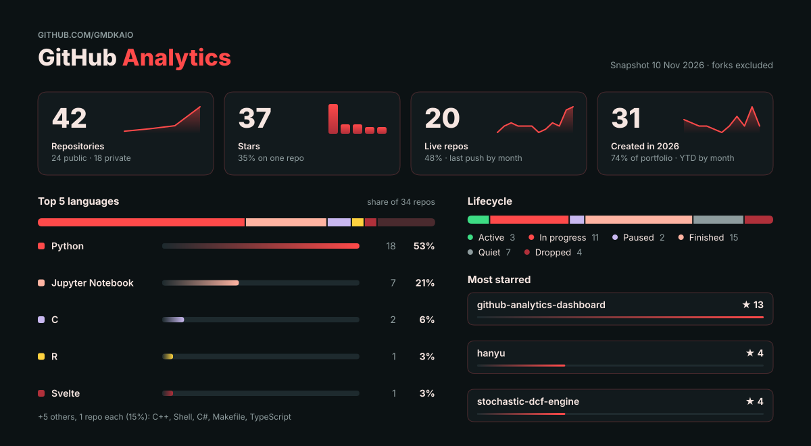

A dashboard of your GitHub repos, drawn as an SVG for your profile README.
A GitHub Action fetches your repos every night, draws the picture and commits it,
so the image above is always about a day old. Only repos you own count, and forks are left out.

## Layouts

Three layouts, picked with `DASHBOARD_LAYOUT`. Each has a default theme.

<table>
<tr>
<td width="50%" valign="top">
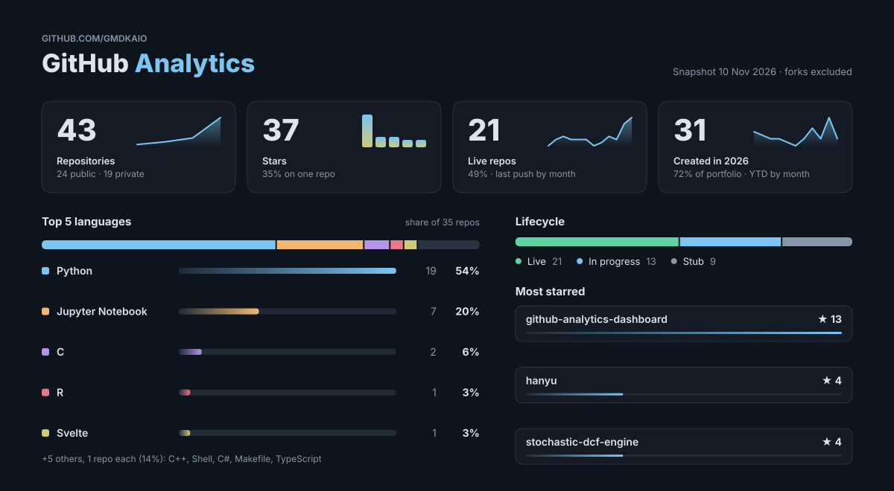<br>
<b><code>card</code></b><br>
<sub>Default · 1200 × 660 · theme <code>redline</code></sub><br>
Four KPI tiles with sparklines, the top languages, lifecycle and the three most starred repos.
</td>
<td width="50%" valign="top">
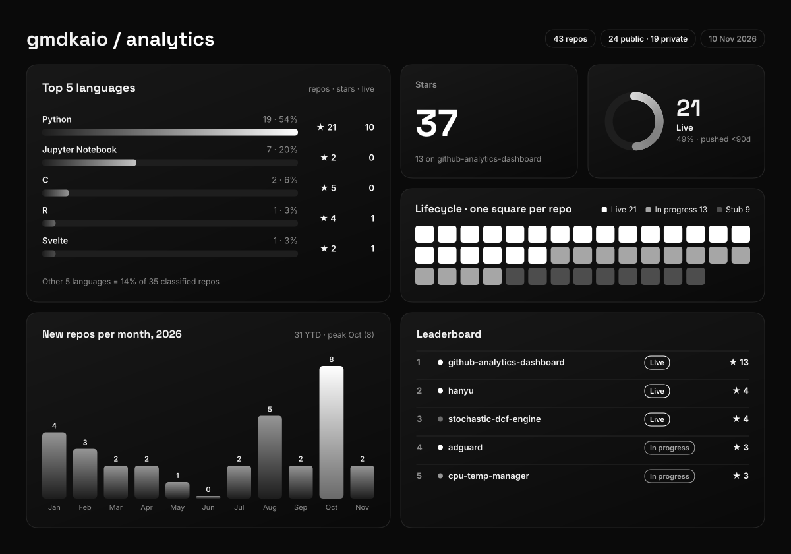<br>
<b><code>bento</code></b><br>
<sub>1200 × 840 · theme <code>mono</code></sub><br>
A grid of tiles: languages with stars and live counts, a live ring, one square per repo, repos per month, a leaderboard.
</td>
</tr>
<tr>
<td width="50%" valign="top">
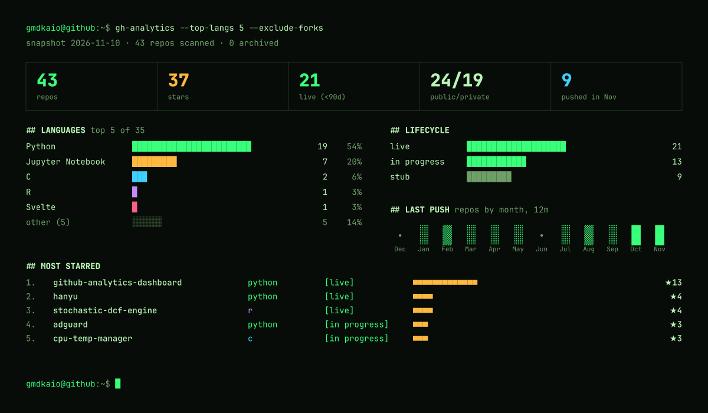<br>
<b><code>terminal</code></b><br>
<sub>1200 × 700 · theme <code>phosphor</code></sub><br>
The same numbers as command output, with block-character bars and a last-push heatmap.
</td>
<td width="50%" valign="top">
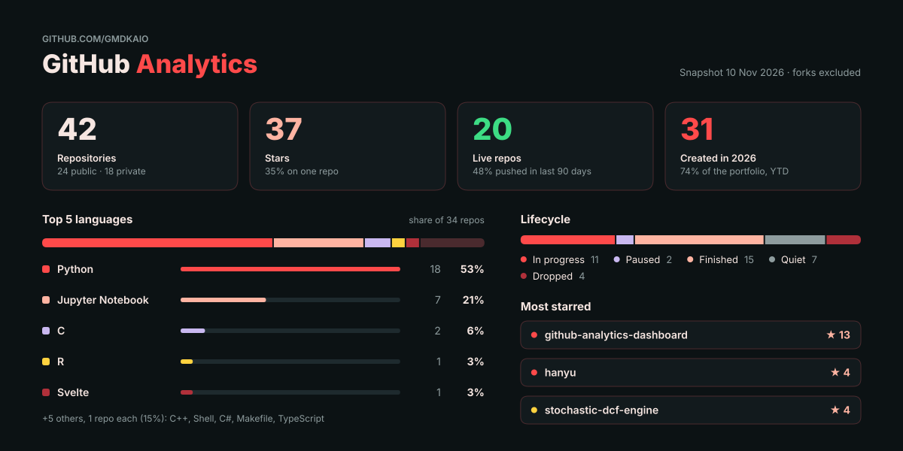<br>
<b><code>card</code> with <code>DASHBOARD_GRADIENTS=0</code></b><br>
<sub>1200 × 600</sub><br>
The flat look: solid bars, no sparklines. Applies to card and bento; terminal has no gradients.
</td>
</tr>
</table>

## Themes

Twelve themes, picked with `DASHBOARD_THEME`. Any theme works with any layout; here they are on the card.

<table>
<tr>
<td width="33%" valign="top">
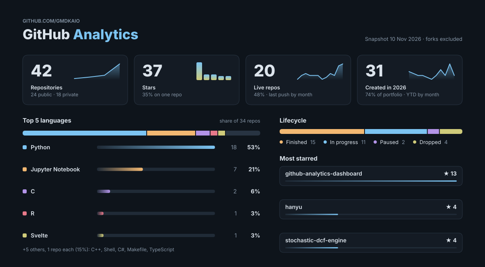<br>
<b><code>frost</code></b><br>
Cool slate, ice-blue lead, mint for Live.
</td>
<td width="33%" valign="top">
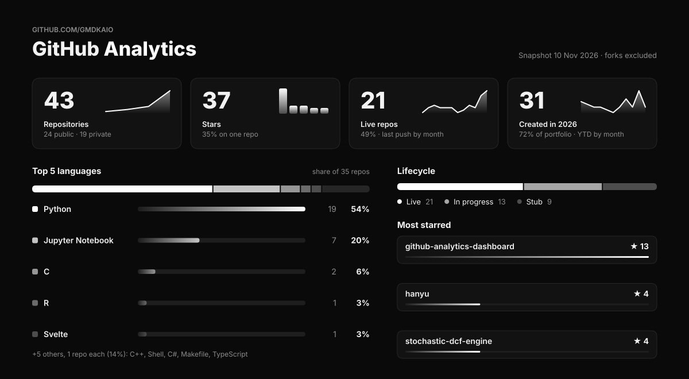<br>
<b><code>mono</code></b><br>
Black to grey to white, no hue.
</td>
<td width="33%" valign="top">
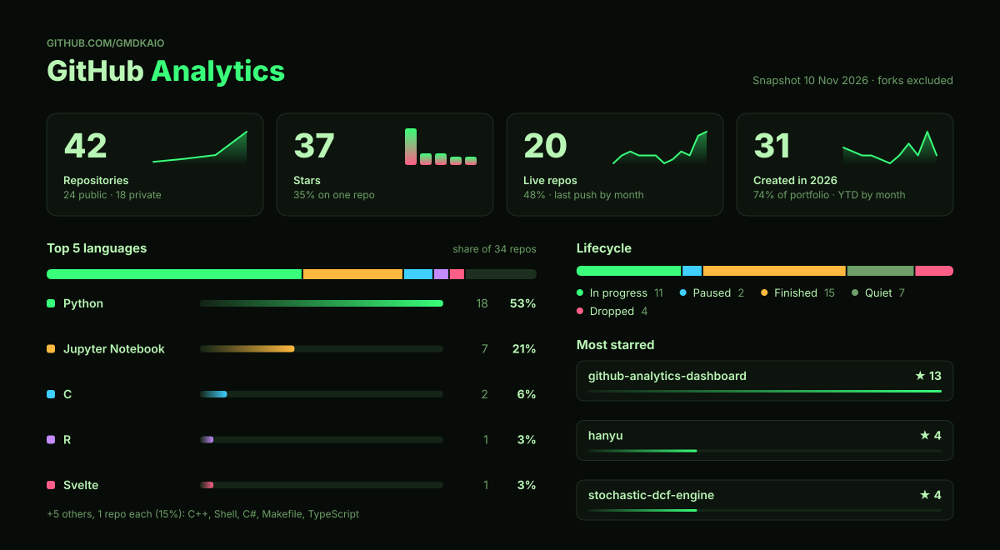<br>
<b><code>phosphor</code></b><br>
CRT green with amber and cyan.
</td>
</tr>
<tr>
<td width="33%" valign="top">
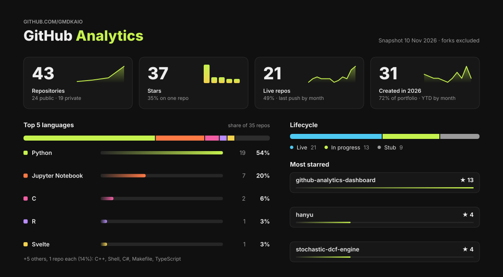<br>
<b><code>graphite</code></b><br>
Neutral black, lime lead.
</td>
<td width="33%" valign="top">
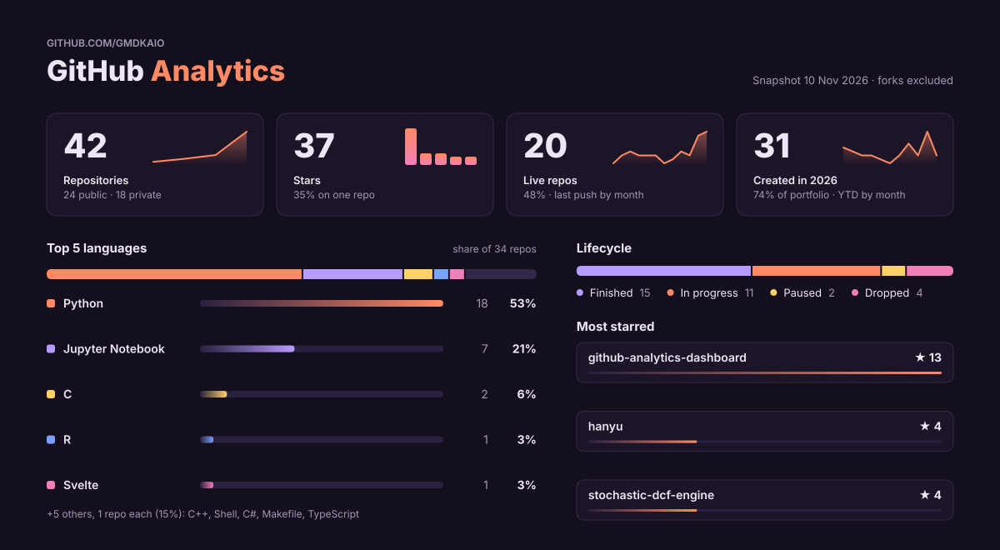<br>
<b><code>dusk</code></b><br>
Deep plum, coral lead.
</td>
<td width="33%" valign="top">
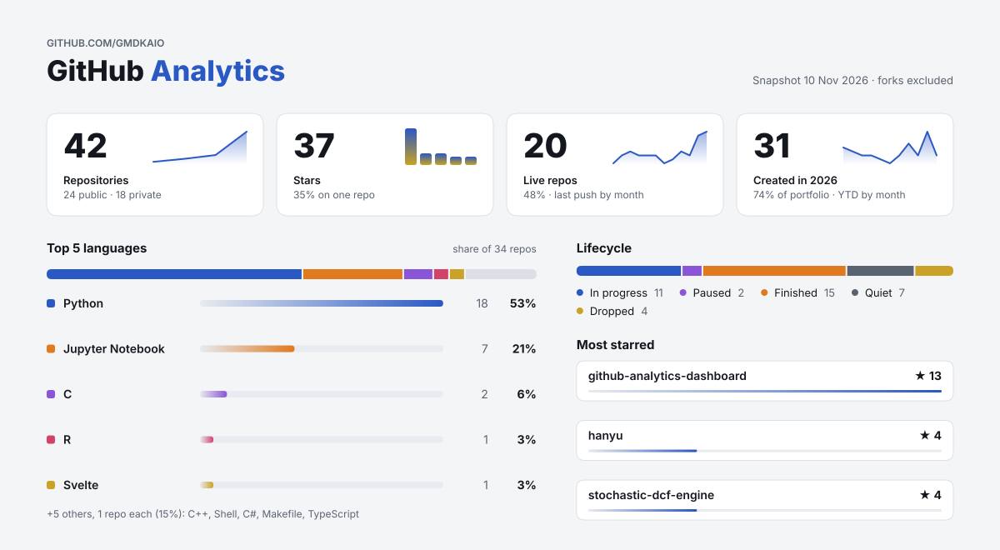<br>
<b><code>daylight</code></b><br>
Light mode.
</td>
</tr>
<tr>
<td width="33%" valign="top">
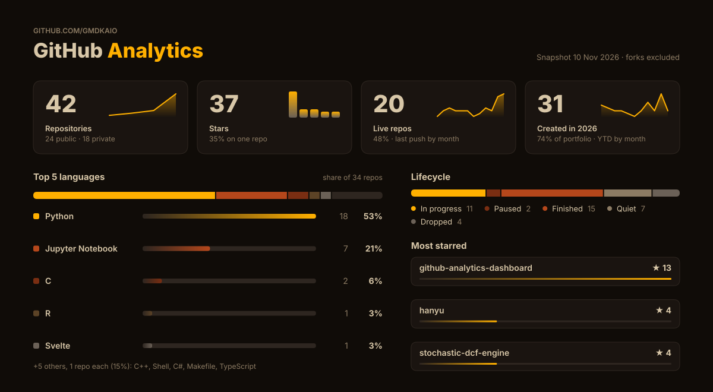<br>
<b><code>divergence</code></b><br>
Amber and auburn, warm and high contrast.
</td>
<td width="33%" valign="top">
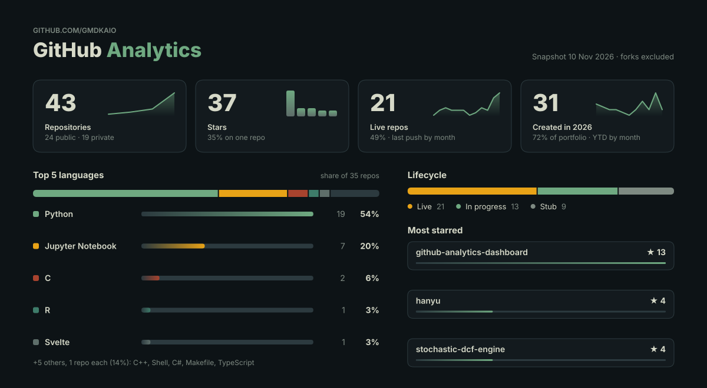<br>
<b><code>lab</code></b><br>
Petrol base with green, amber and auburn.
</td>
<td width="33%" valign="top">
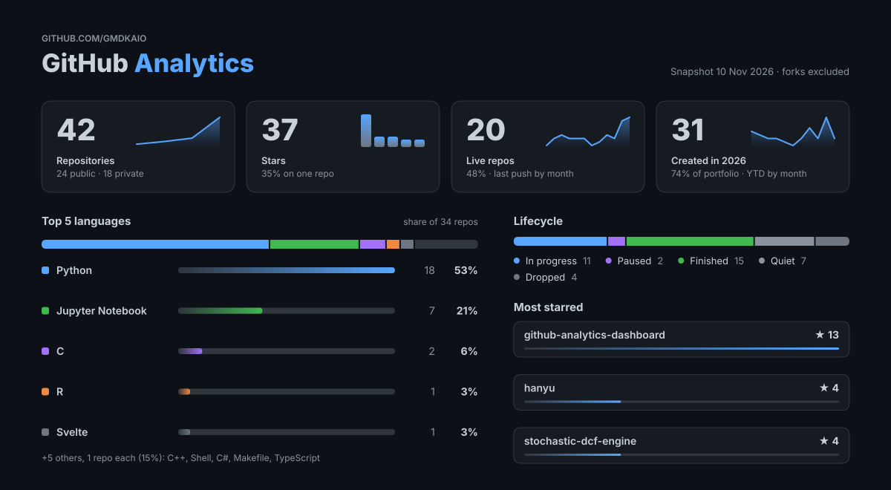<br>
<b><code>github</code></b><br>
GitHub's own dark palette.
</td>
</tr>
<tr>
<td width="33%" valign="top">
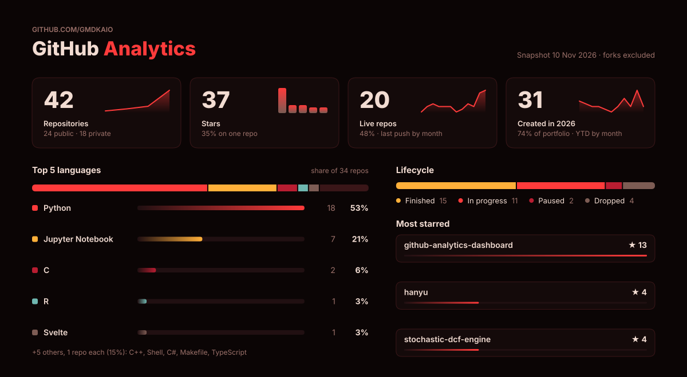<br>
<b><code>worldline</code></b><br>
Red terminal with nixie-tube amber, after the Steins;Gate divergence meter.
</td>
<td width="33%" valign="top">
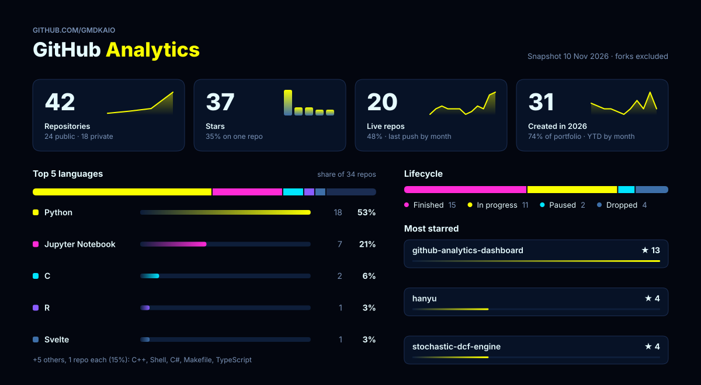<br>
<b><code>edgerunner</code></b><br>
Yellow, magenta and cyan on deep blue, sampled from Cyberpunk: Edgerunners.
</td>
<td width="33%" valign="top">
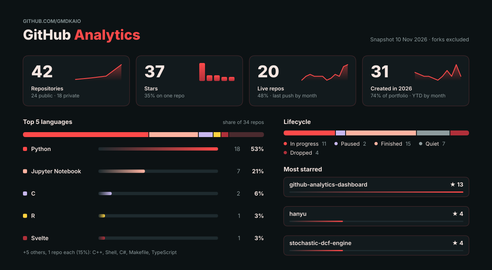<br>
<b><code>redline</code></b><br>
The Edgerunners netrunning HUD: coral red on dark teal, green for Live.
</td>
</tr>
</table>

The layout and theme pictures are a snapshot, made with `python scripts/readme_previews.py`.
Only the dashboard at the top updates every night.

## Make it yours

| To | Change |
|---|---|
| Pick the layout, theme or flat look | Repository variables `DASHBOARD_LAYOUT`, `DASHBOARD_THEME`, `DASHBOARD_GRADIENTS` (Settings → Secrets and variables → Actions → Variables). An empty theme means the layout's default. |
| List more or fewer languages | `TOP_N` in `assets/layouts/common.py`. Colors repeat after 5. The card fits about 10 rows, bento and terminal about 7. |
| Exclude or include languages | `FILTERED_LANGS` in `assets/layouts/common.py`. HTML, CSS and JavaScript are left out by default because they are usually a side effect of a repo, not what it is written in. |
| Show private repos in the leaderboards | `SHOW_PRIVATE = True` in `assets/layouts/common.py`. Their names then appear in the public SVG. |
| Count forks | Remove the fork filter in `src/transform.py`. |
| Mark a repo's status | Add one topic to the repo on GitHub: `wip`, `paused`, `finished` or `dropped`. No code change. |
| Change the status topics or the 90-day cutoff | `STATUS_TOPICS` and `lifecycle()` in `src/transform.py`. |
| Add a theme | Copy a block in `src/palettes.py` and change the colors. `track`, `prog` and `stub` are optional. |
| Change the update time | The `cron` line in `.github/workflows/update-dashboard.yml` (daily at 00:00 UTC). |

## How the numbers work

- Lifecycle comes from a status topic you set on each repo: `wip` is In progress, `paused` is Paused, `finished` is Finished, `dropped` is Dropped. An archived repo is always Archived. Untagged repos fall back to recency: Active if pushed in the last 90 days, Quiet after that.
- Live repos counts every repo pushed in the last 90 days, whatever its tag.
- Only repos you own are counted: no forks, no organization or collaborator repos.
- Top languages: repos with no language or a filtered one are dropped, the rest are counted per language and sorted by count, then total stars, then name, so ties always land in the same order. Everything past `TOP_N` goes into "Other". Percentages are of the counted repos, rounded, so they may not add up to exactly 100.
- Last push by month counts repos by the month of their latest push, which is not the same as commit activity.
- Counts include private repos; names don't. The CSV the pipeline writes (`data/github_repos_clean.csv`) has every repo name, so it stays on your machine and out of git.

## Set it up

1. Fork or clone this repo and keep it public.
2. Add two repository secrets: `GH_TOKEN`, a personal access token with `repo` scope (needed to count private repos), and `USERNAME`, your GitHub username.
3. Enable Actions, then run "Update GitHub Analytics Dashboard" once from the Actions tab.
4. Add the image to your profile README:

```markdown

```

To run it locally, you need Python 3.11+ and a `.env` with `GITHUB_TOKEN` and `USERNAME`:

```bash
python -m venv .venv
source .venv/bin/activate        # Windows: .venv\Scripts\activate
pip install -r requirements.txt
DASHBOARD_LAYOUT=bento python src/main.py
python tests/smoke_test.py       # renders every layout and theme from a fixed dataset
```

## Licence

[MIT](LICENSE). The dashboard uses the [Inter](https://github.com/rsms/inter),
[Space Grotesk](https://github.com/floriankarsten/space-grotesk) and
[JetBrains Mono](https://github.com/JetBrains/JetBrainsMono) fonts, under the SIL
Open Font License 1.1 (licence files in `assets/fonts/`).
